# Passo Seguro — Generative AI for Engineering

Assistente do pedestre: um LLM local pequeno especializado com **RAG + LoRA**, que responde
dúvidas sobre calçadas, travessias e como reclamar em São Paulo **citando a lei ou a página
oficial**, e que **recusa** quando a resposta não está na base.

Ficha Técnica: [README do repositório principal](https://github.com/Passo-Seguro/passo-seguro#ficha-técnica)

## Integrantes
| Nome completo | RM |
|---|---|
| Guilherme Morais | 551981 |
| Júlia Marques | 98680 |
| Matheus Gusmão | 550826 |

## Sumário

1. [Ficha técnica](#1-ficha-técnica)
2. [Como funciona](#2-como-funciona)
3. [Resultados](#3-resultados)
4. [Requisitos e máquina usada](#4-requisitos-e-máquina-usada)
5. [Instalação](#5-instalação)
6. [Como usar o assistente (API)](#6-como-usar-o-assistente-api)
7. [Como rodar o pipeline completo](#7-como-rodar-o-pipeline-completo)
8. [Testes](#8-testes)
9. [Registro da execução de 08/11/2026](#9-registro-da-execução-de-08112026)
10. [Estrutura do repositório](#10-estrutura-do-repositório)
11. [Solução de problemas](#11-solução-de-problemas)
12. [Links](#12-links)

---

## 1. Ficha técnica

| Campo | |
|---|---|
| Tarefa | Responder dúvidas de pedestres de São Paulo sobre calçadas, travessias e como reclamar, citando a fonte, em JSON. |
| Por que importa | Reclamar de calçada hoje é confuso: o pedestre não sabe se o problema é do dono do imóvel, da Prefeitura ou de uma concessionária, nem qual serviço do 156 usar. |
| Modelo | Qwen2.5-1.5B-Instruct (Apache 2.0), quantizado em Q4_K_M, rodando no Ollama |
| Especialização | LoRA (rank 16, alpha 32) com 324 exemplos (28% recusas), revisados exemplo a exemplo (revisão feita por IA, a conferir: [`treino/revisao_ia.json`](treino/revisao_ia.json)) |
| Busca | `intfloat/multilingual-e5-base` + FAISS (10 candidatos) → reranker `mmarco-mMiniLMv2` → top-3; limiar 0,17 escolhido no dev |
| Saída | JSON validado (Pydantic): `{"resposta", "fontes", "confianca", "recusou"}` |
| Integração | `POST /assistente`, consumido pelo app (PWA) via API principal |
| IA responsável | O app sempre mostra as fontes; sem base, recusa e aponta o SP156; as perguntas não são guardadas nem registradas no log; o viés com linguagem informal é medido no placar |

### Base de conhecimento

Gerada por `scripts/02_fatiar.py` ([`base/tabela_base.md`](base/tabela_base.md)). A NBR 9050 fica
fora: é norma da ABNT, protegida por direito autoral.

| Fonte | Formato | Licença | Trechos |
|---|---|---|---|
| Código de Trânsito Brasileiro (Lei 9.503/1997) | HTML | Ato oficial (domínio público) | 18 |
| Lei Brasileira de Inclusão (Lei 13.146/2015) | HTML | Ato oficial (domínio público) | 11 |
| Lei municipal 15.442/2011 | HTML | Ato oficial (domínio público) | 11 |
| Decreto municipal 59.671/2020 | HTML | Ato oficial (domínio público) | 16 |
| Subprefeituras: calçadas e serviços do 156 | HTML | Publicação oficial da Prefeitura | 10 |
| Cartilha de Calçadas 2023 (SMPED) | PDF | Publicação oficial da Prefeitura | 16 |
| **Total** | | | **82** |

## 2. Como funciona

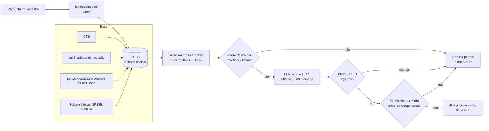

1. **Busca.** O e5 encontra os 10 trechos oficiais mais parecidos com a pergunta. O reranker relê
   cada par pergunta–trecho e reordena. Os 3 melhores seguem adiante.
2. **Recusa pela busca.** Se o melhor trecho tiver score abaixo do limiar
   (`avaliacao/limiar.json`, calibrado no dev), o serviço recusa **sem chamar o LLM**.
3. **Geração.** O LLM local responde só com base nos trechos: o modelo base na configuração B, o
   ajustado com LoRA na C. A saída é JSON forçado pelo schema.
4. **Validação.** O Pydantic valida o JSON. Se vier inválido, tenta mais uma vez; se falhar de
   novo, recusa.
5. **Citação.** Fonte citada que não está entre os trechos recuperados é descartada. Se não
   sobrar nenhuma, a resposta vira recusa: o app sempre mostra de onde veio a informação.

O placar compara três configurações: **A** (modelo sem contexto), **B** (RAG simples) e **C**
(RAG + LoRA).

## 3. Resultados

### Placar (45 perguntas de teste)

Gerado pelo notebook `05_placar.ipynb` (`avaliacao/avaliar.py`), em
[`avaliacao/resultados/placar.md`](avaliacao/resultados/placar.md). O critério de julgamento está
em [`avaliacao/criterio.md`](avaliacao/criterio.md). As três configurações usam o mesmo
Qwen2.5-1.5B quantizado em Q4_K_M e o mesmo contexto da busca.

| Configuração | Exatidão | Citação correta | Alucinação | Recusa correta (não consta) | Recusa indevida | JSON válido | Latência |
|---|---|---|---|---|---|---|---|
| A — modelo sem contexto | 23% | 0% | 100% | 0% | 0% | 100% | 0,30 s |
| B — RAG simples | **43%** | 50% | 36% | 80% | 23% | 98% | 0,35 s |
| **C — RAG + LoRA (no ar)** | 40% | **53%** | **29%** | **87%** | 23% | **100%** | **0,23 s** |

| Registro | A exatidão | B exatidão | C exatidão | B alucinação | C alucinação | B recusa indevida | C recusa indevida |
|---|---|---|---|---|---|---|---|
| formal (17 perguntas) | 33% | 67% | 67% | 47% | **24%** | 0% | 8% |
| informal (28 perguntas) | 17% | 28% | 22% | 29% | 32% | 39% | 33% |

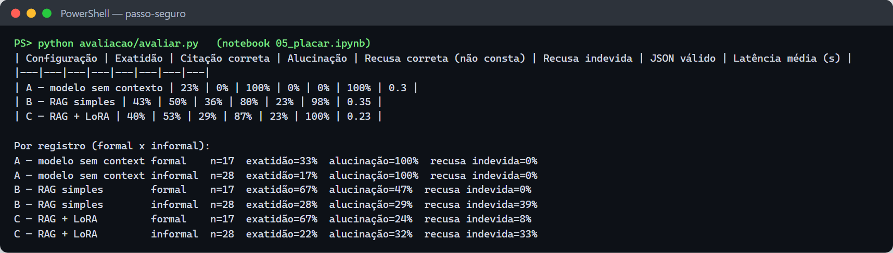

- **A → B (efeito do RAG):** a exatidão quase dobra e a alucinação cai de 100% para 36%. Sem
  contexto, o modelo nunca cita uma fonte válida. O custo são 23% de recusas indevidas.
- **B → C (efeito do LoRA):** a exatidão fica praticamente igual. A diferença de 3 pontos está
  dentro da variação entre execuções: B variou de 43% a 50% e C de 37% a 40% em três rodadas.
  Mas C alucina menos, recusa melhor o que não está na base, devolve JSON válido sempre e é mais
  rápido. Nas perguntas formais, a alucinação cai à metade. O LoRA ensinou formato, citação e
  recusa, mas não acrescentou conhecimento: os erros que vêm da busca continuam.
- **Formal × informal:** as perguntas informais acertam bem menos e concentram as recusas
  indevidas, porque o reranker dá notas baixas a "tá", "pra" e "a gente". É o maior ponto de
  melhoria, porque o pedestre fala assim.
- **Configuração escolhida: C** (`CONFIG_VENCEDORA=C`). Empata com B em exatidão e é mais segura.

> ⚠️ **Falha grave conhecida (B e C):** "carro na calçada pode?" recebe uma resposta errada nas
> duas configurações. B responde "Sim, o carro pode estar na calçada…"; C responde "Sim" e fala de
> bicicleta. A busca traz a cartilha e o art. 68 no lugar dos arts. 181 e 193 do CTB, então nenhum
> dos dois modelos tem o trecho certo. **Corrija a busca para essa pergunta (ex.: expansão de
> consulta "carro" → "estacionar veículo / transitar com veículo") antes de colocar em produção.**

Os cinco erros reais, com causa e correção, estão em
[`avaliacao/resultados/cinco_erros.md`](avaliacao/resultados/cinco_erros.md).

### Busca

| Configuração | recall@1 (dev) | recall@3 (dev) | recall@1 (40) | recall@3 (40) | s/pergunta em CPU |
|---|---|---|---|---|---|
| só e5 | 0,20 | 0,20 | 0,30 | 0,60 | 0,01 |
| e5 + `mmarco-mMiniLMv2` (**adotado**) | 0,40 | 0,60 | 0,475 | **0,775** | ~1,1 |
| e5 + `bge-reranker-v2-m3` | 0,50 | 0,60 | 0,625 | 0,80 | ~11,5 |

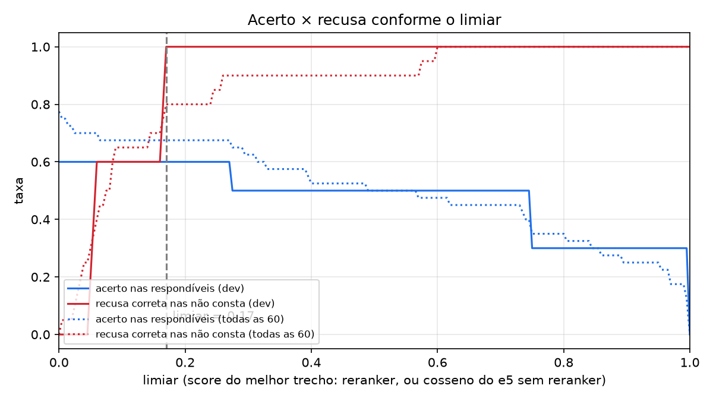

### LoRA

| Item | Valor |
|---|---|
| Exemplos | 435 gerados (professor `qwen2.5:7b-instruct`), 324 aprovados: 233 respostas, 26 recusas fora de escopo, 65 recusas sem base |
| Treino / validação | 292 / 32, 3 épocas, batch efetivo 16, lr 2e-4 cosseno, bf16 |
| Perda de validação | 0,218 → 0,186 → 0,183 (sem sobreajuste) |
| Duração | 13 min na RTX 4080 |

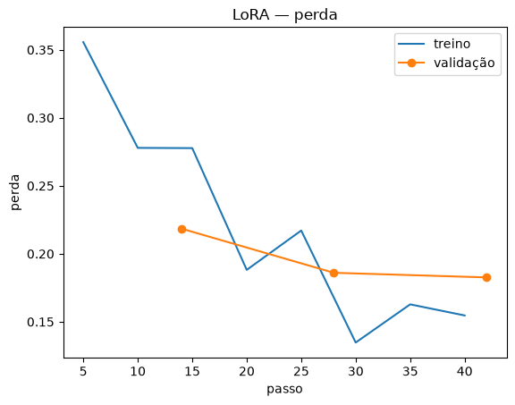

## 4. Requisitos e máquina usada

**Mínimo para usar o assistente (API):** Python 3.11 ou 3.12, 8 GB de RAM, Ollama
(<https://ollama.com/download>). Roda em CPU.

**Para treinar o LoRA:** GPU NVIDIA com 8 GB de VRAM (ou 4 a 6 GB com `--4bit`) e driver 580 ou
mais novo para CUDA 13. Sem GPU, use o Google Colab (seção 7.5).

**Máquina usada no treino e em todos os testes deste repositório:**

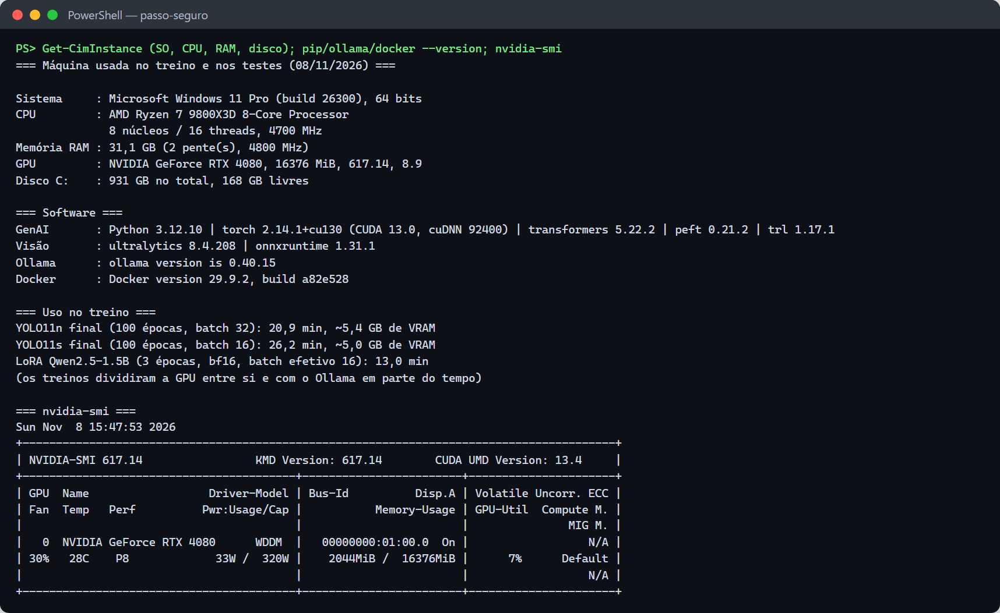

| Item | Usado |
|---|---|
| Sistema | Windows 11 Pro 64 bits (build 26300) |
| CPU | AMD Ryzen 7 9800X3D, 8 núcleos / 16 threads |
| RAM | 31 GB |
| GPU | NVIDIA GeForce RTX 4080, 16 GB, driver 617.14, CUDA 13.0 |
| Software | Python 3.12.10, PyTorch 2.14.1+cu130, transformers 5.22.2, peft 0.21.2, trl 1.17.1, Ollama 0.40.15, Docker 29.9.2 |

## 5. Instalação

Os comandos estão em PowerShell (Windows). No Linux ou no Mac, troque
`.venv\Scripts\Activate.ps1` por `source .venv/bin/activate`.

```powershell
git clone https://github.com/Passo-Seguro/passo-seguro-genai
cd passo-seguro-genai
python -m venv .venv
.venv\Scripts\Activate.ps1
python -m pip install --upgrade pip

# PyTorch com CUDA primeiro (senão o pip instala a versão só-CPU).
# cu130 exige driver NVIDIA 580 ou mais novo; com driver antigo use .../whl/cu126.
pip install torch --index-url https://download.pytorch.org/whl/cu130

pip install -r requirements/dev.txt         # RAG, avaliação, API, notebooks, testes
pip install -r requirements/treino.txt      # só para treinar o LoRA
copy .env.exemplo .env

ollama pull qwen2.5:1.5b-instruct          # modelo base, ~1 GB
python scripts/00_verificar_ambiente.py    # confere Python, GPU, pacotes e Ollama
python -m pytest -q                        # 27 testes
```

A base (`base/trechos.jsonl`), o índice (`base/indice/`) e o limiar (`avaliacao/limiar.json`) já
vêm no repositório. Para só usar o assistente, não é preciso rodar o pipeline.

**Por que Qwen2.5-1.5B-Instruct:** tem de 1 a 4 bilhões de parâmetros (pedido do guia), licença
Apache 2.0, fala português e roda em CPU em poucos segundos quando quantizado, o que cabe no
timeout de 15 s da API. Para trocar de modelo, mude `MODELO_HF` e `OLLAMA_MODELO_BASE` no `.env`;
os dois têm de ser o mesmo modelo. Cuidado: o Qwen2.5-3B **não** é Apache.

## 6. Como usar o assistente (API)

### 6.1 Subir o serviço

> A configuração C precisa do modelo `passo-seguro-lora` no Ollama (seção 7.5). Sem ele, toda
> pergunta que passa do limiar cai na resposta de contingência; nesse caso, use `CONFIG_VENCEDORA=B`.

**Local:**

```powershell
.venv\Scripts\Activate.ps1
$env:ASSISTENTE_TOKEN="token-local"; $env:CONFIG_VENCEDORA="C"
uvicorn api.app:app --port 8002
```

**Docker, só a API** (o Ollama fica no host):

```powershell
docker build -f deploy/Dockerfile.api -t ghcr.io/passo-seguro/passo-seguro-genai:local .
docker run --rm -p 8002:8000 -e ASSISTENTE_TOKEN=token-local -e CONFIG_VENCEDORA=C `
  -e OLLAMA_URL=http://host.docker.internal:11434 ghcr.io/passo-seguro/passo-seguro-genai:local
```

**Docker Compose** (Ollama e API juntos):

```powershell
docker compose -f deploy/docker-compose.yml up --build
docker compose -f deploy/docker-compose.yml exec ollama ollama pull qwen2.5:1.5b-instruct
docker compose -f deploy/docker-compose.yml exec ollama ollama create passo-seguro-lora -f /modelos/Modelfile.gguf
```

**Railway** (imagem única com Ollama + modelo GGUF + API; é onde o Terraform da Júlia espera o
assistente, em `assistente_url` e `assistente_token`):

```powershell
docker build -f deploy/Dockerfile.railway -t passo-seguro-assistente .
docker run --rm -p 8000:8000 -e ASSISTENTE_TOKEN=troque passo-seguro-assistente
```

**No ar:** https://assistente-production-307b.up.railway.app (`GET /saude`, `POST /assistente`
com `Authorization: Bearer <ASSISTENTE_TOKEN>`; o token fica com a equipe, fora do git).

Como foi publicado (projeto `passo-seguro-genai`, serviço `assistente`):

```powershell
railway login
railway link                       # projeto passo-seguro-genai, serviço assistente
railway variables --set "RAILWAY_DOCKERFILE_PATH=deploy/Dockerfile.railway" `
  --set "ASSISTENTE_TOKEN=<token>" --set "PORT=8000" --set "TIMEOUT_LLM_S=90" `
  --set "MODELO_GGUF_URL=https://github.com/Passo-Seguro/passo-seguro-genai/releases/download/modelo-v1/passo-seguro-lora-q4_K_M.gguf"
railway up --detach
```

- O `.gguf` (941 MB) não vai para o git e passa do limite de upload do `railway up` (413): ele fica
  no release [`modelo-v1`](https://github.com/Passo-Seguro/passo-seguro-genai/releases/tag/modelo-v1)
  e o build baixa de `MODELO_GGUF_URL`. O [`.railwayignore`](.railwayignore) envia só o que a imagem usa.
- `PORT=8000`: o Railway injeta `PORT=8080`, e o domínio aponta para a 8000.
- Threads: o container enxerga os 48 núcleos da máquina física, mas tem cota de 8 vCPUs. Com 48
  threads, torch e llama.cpp se atropelavam e o LLM estourava o timeout (111 s, resposta de
  contingência). O `entrypoint.sh` lê a cota do cgroup e fixa `OMP_NUM_THREADS` e `num_thread`;
  depois disso, ~6–7 s por resposta. `NUM_THREADS` sobrescreve.
- RAM: uns 3 GB; se faltar, use `MODELO_EMBEDDINGS` `intfloat/multilingual-e5-small` (exige reindexar).

Passe a URL e o token para a Júlia pôr no `terraform.tfvars`.

A documentação interativa (Swagger) fica em <http://localhost:8002/docs>:

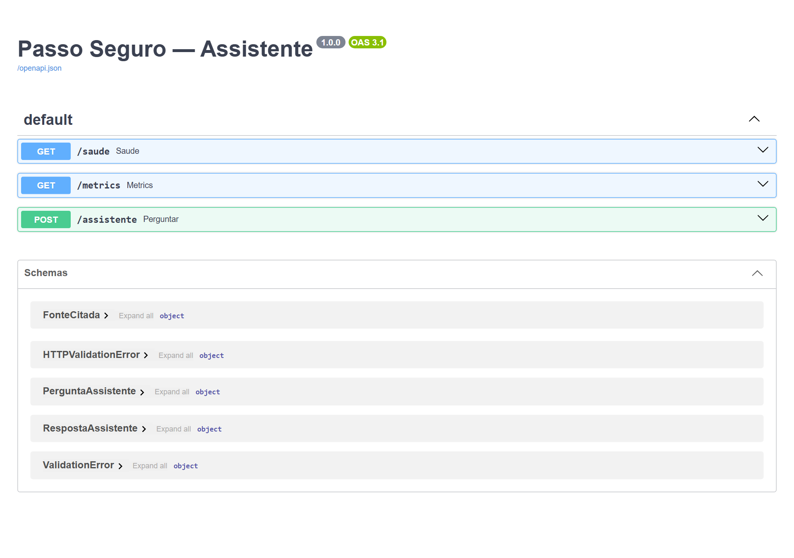

### 6.2 Contrato

**Requisição:** `POST /assistente`, `Content-Type: application/json`, cabeçalho
`Authorization: Bearer <ASSISTENTE_TOKEN>`. O campo `pergunta` é obrigatório e tem de 1 a 500
caracteres.

```json
{"pergunta": "Quem tem prioridade na faixa de pedestre?"}
```

**Resposta 200:**

| Campo | Tipo | Significado |
|---|---|---|
| `resposta` | string | texto para o pedestre. Na recusa, a mensagem padrão com o link do SP156 |
| `fontes` | lista | `{titulo, url}` de cada fonte usada. Vazia na recusa |
| `confianca` | número 0..1 | confiança declarada pelo modelo. Na recusa, no máximo 0,3 |
| `recusou` | booleano | `true` quando a base não sustenta a resposta |

O app deve **sempre** mostrar as fontes e, quando `recusou` for `true`, oferecer o registro do
problema no próprio Passo Seguro.

**Respondida (saída real):**

```json
{"resposta": "Os pedestres que estiverem atravessando a via sobre as faixas delimitadas para esse fim terão prioridade de passagem, exceto nos locais com sinalização semafórica, onde deverão ser respeitadas as disposições deste Código.",
 "fontes": [{"titulo": "Código de Trânsito Brasileiro (Lei nº 9.503/1997), Art. 70",
             "url": "https://www.planalto.gov.br/ccivil_03/leis/l9503compilado.htm"}],
 "confianca": 1.0, "recusou": false}
```

**Recusa (saída real)** para "Qual a melhor ação para investir este mês?":

```json
{"resposta": "Não encontrei isso nas fontes oficiais que eu consulto. Para falar com a Prefeitura, ligue 156 ou acesse o SP156: https://sp156.prefeitura.sp.gov.br/ — e você pode registrar o problema aqui no Passo Seguro.",
 "fontes": [], "confianca": 0.0, "recusou": true}
```

### 6.3 Exemplos de chamada

**curl (bash):**

```bash
curl -X POST http://localhost:8002/assistente \
  -H "Authorization: Bearer token-local" \
  -H "Content-Type: application/json; charset=utf-8" \
  -d '{"pergunta": "Quem tem prioridade na faixa de pedestre?"}'
```

**PowerShell** (o `curl.exe` do Windows pode mandar acentos fora de UTF-8; use
`Invoke-RestMethod`):

```powershell
$corpo = @{ pergunta = "carro na calçada pode?" } | ConvertTo-Json
Invoke-RestMethod -Method Post -Uri http://localhost:8002/assistente `
  -Headers @{ Authorization = "Bearer token-local" } `
  -ContentType "application/json; charset=utf-8" -Body ([Text.Encoding]::UTF8.GetBytes($corpo))
```

**Python:**

```python
import httpx

r = httpx.post("http://localhost:8002/assistente",
               headers={"Authorization": "Bearer token-local"},
               json={"pergunta": "a raiz da árvore levantou a calçada, de quem é a culpa?"},
               timeout=15)
r.raise_for_status()
dados = r.json()
print(dados["resposta"])
for f in dados["fontes"]:
    print("-", f["titulo"], f["url"])
```

**JavaScript:**

```js
const r = await fetch("http://localhost:8002/assistente", {
  method: "POST",
  headers: { Authorization: "Bearer token-local", "Content-Type": "application/json" },
  body: JSON.stringify({ pergunta: "bike pode andar na calçada?" }),
  signal: AbortSignal.timeout(15000),
});
const { resposta, fontes, recusou } = await r.json();
```

Chamadas reais (saúde, 401, 422, 400, respostas, cache, métricas e log):

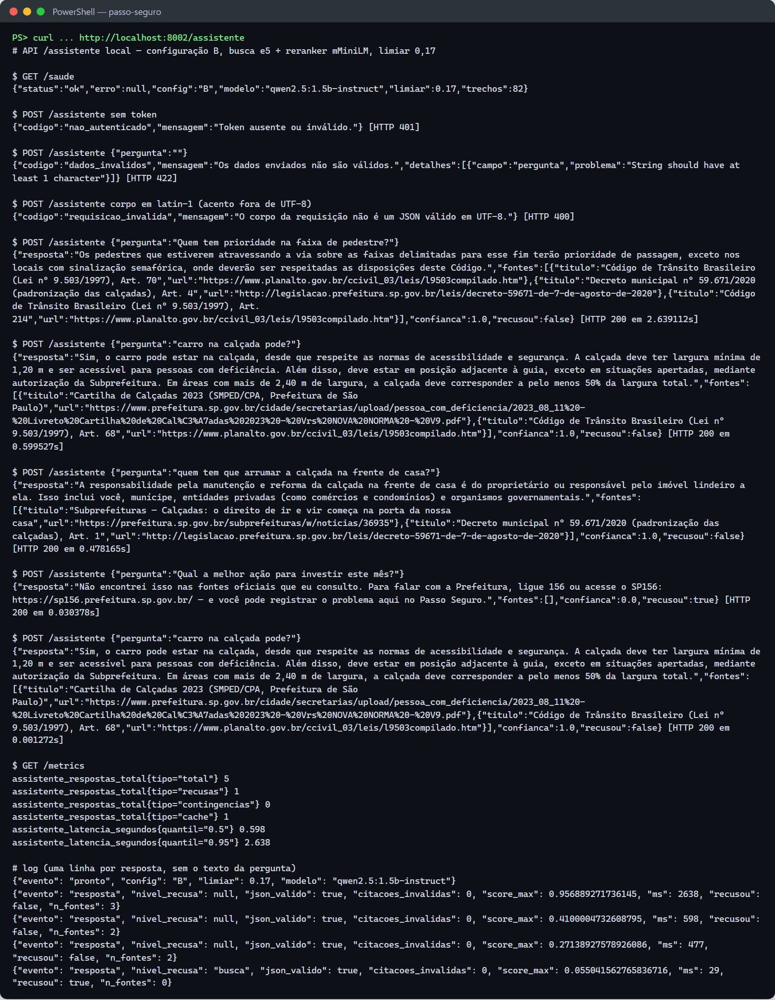

### 6.4 Erros, saúde e métricas

| Status | `codigo` | Quando |
|---|---|---|
| 401 | `nao_autenticado` | sem o cabeçalho `Authorization` ou com o token errado |
| 422 | `dados_invalidos` | `pergunta` ausente, vazia ou com mais de 500 caracteres |
| 400 | `requisicao_invalida` | o corpo não é JSON válido em UTF-8 |
| 200 com `recusou: true` | — | o LLM não respondeu em 12 s (`TIMEOUT_LLM_S`) ou a base não carregou: resposta de contingência com o link do SP156 |

A API principal tem timeout de 15 s; o serviço desiste do LLM aos 12 s para sempre responder
dentro do prazo.

- `GET /saude`: 200 com a base carregada, 503 (`"status": "sem_base"`) sem ela.
- `GET /metrics`: formato Prometheus (total, recusas, contingências, cache, latência p50 e p95).
- **Log:** JSON, uma linha por resposta, **sem o texto da pergunta**:
  `{"evento": "resposta", "nivel_recusa": null, "json_valido": true, "score_max": 0.96, "ms": 2638, "recusou": false, "n_fontes": 3}`.

### 6.5 Configuração

Todas as variáveis podem ir no `.env` (ver [`.env.exemplo`](.env.exemplo)).

| Variável | Padrão | Para quê |
|---|---|---|
| `ASSISTENTE_TOKEN` | vazio | token Bearer, o mesmo da API principal. Vazio desliga a autenticação |
| `CONFIG_VENCEDORA` | C | `B` (modelo base) ou `C` (modelo com LoRA) |
| `OLLAMA_URL` | `http://localhost:11434` | onde está o Ollama |
| `OLLAMA_MODELO_BASE` / `OLLAMA_MODELO_LORA` | `qwen2.5:1.5b-instruct` / `passo-seguro-lora` | modelos de A/B e de C |
| `MODELO_EMBEDDINGS` | `intfloat/multilingual-e5-base` | trocar exige reindexar (`03`) |
| `MODELO_RERANKER` | `cross-encoder/mmarco-mMiniLMv2-L12-H384-v1` | vazio = só o e5; trocar exige recalibrar o limiar (`04`) |
| `CANDIDATOS` / `TOP_K` | 10 / 3 | trechos relidos pelo reranker / enviados ao prompt |
| `LIMIAR` | de `avaliacao/limiar.json` | score mínimo do melhor trecho para chamar o LLM |
| `TIMEOUT_LLM_S` | 12 na API, 60 nos scripts | tempo máximo esperando o LLM |
| `CACHE_TAMANHO` | 256 | perguntas repetidas guardadas em memória |
| `NIVEL_LOG` | INFO | nível do log |

### 6.6 Como biblioteca Python e pela linha de comando

```python
import sys; sys.path.insert(0, "src")
from passo_genai.busca import Buscador
from passo_genai.gerador import Assistente, para_contrato

buscador = Buscador.carregar()            # índice + reranker
assistente = Assistente(buscador)         # usa o Ollama de OLLAMA_URL
r = assistente.responder("quem conserta a calçada na frente de casa?", config="B")
print(r.nivel_recusa, r.score_max, r.ids_recuperados)
print(para_contrato(r, buscador.por_id).model_dump())
```

```powershell
python scripts/05_testar_geracao.py --pergunta "o carro tá em cima da calçada, pode?"   # configuração B
python scripts/05_testar_geracao.py --config A                                          # 15 perguntas dev, sem contexto
```

## 7. Como rodar o pipeline completo

Cada script também é uma **tarefa do VS Code** (`Ctrl+Shift+P` → **Tasks: Run Task**). A GPU só é
necessária para o LoRA (7.5).

### 7.1 Conjunto de teste

`avaliacao/teste.jsonl` tem 60 perguntas: 40 respondíveis e 20 "não consta", 15 de
desenvolvimento e 45 de teste, marcadas como formais ou informais. Cada respondível tem
`resposta_esperada`, `trecho_id` (prefixo, ex.: `ctb-art181`) e `criterio`. **Regra:** as 45 de
teste só rodam no placar. Ajuste prompt, limiar e trechos olhando só as 15 de `dev`.

### 7.2 Base de conhecimento

```powershell
python scripts/01_baixar_base.py      # baixa as fontes de base/fontes.yaml (URL, data de acesso, sha256)
python scripts/02_fatiar.py           # trechos por artigo/seção, 300 a 500 tokens -> base/trechos.jsonl
```

- Se o Planalto bloquear o download (`FALHOU`), abra a URL no navegador → `Ctrl+S` → "Página da
  Web, somente HTML" → salve em `base/brutos/<id>.html` e rode o `01` de novo.
- As 4 páginas do SP156 estão com `ativo: false` em `base/fontes.yaml`: preencha a URL de cada
  serviço e troque para `ativo: true`.

### 7.3 Busca

```powershell
python scripts/03_indexar.py          # embeddings e5 -> base/indice/
python scripts/04_avaliar_busca.py    # recall@1/@3 e limiar -> avaliacao/limiar.json, resultados/curva_limiar.png
```

O limiar é escolhido no dev pelo melhor equilíbrio entre acerto nas respondíveis e recusa correta
nas "não consta". Trocar o reranker exige rodar o `04` de novo.

### 7.4 Geração

```powershell
python scripts/05_testar_geracao.py --config B
```

Mostra, para cada pergunta dev, o top-3 com os scores, o nível da recusa, o JSON e o julgamento.

### 7.5 LoRA

```powershell
ollama pull qwen2.5:7b-instruct                       # professor (~5 GB) ou PROFESSOR_URL no .env
python scripts/06_gerar_exemplos.py --alvo 300        # ~25% recusas, sem vazamento do teste
python scripts/07_revisar_exemplos.py                 # revisão: a = aprovar, e = editar, r = rejeitar
python scripts/07_revisar_exemplos.py --exportar      # treino/treino.jsonl + estatisticas.md
python scripts/08_treinar_lora.py                     # 8 GB de VRAM ou mais
python scripts/08_treinar_lora.py --4bit --batch 1 --acumulacao 16   # 4 a 6 GB (QLoRA)
python scripts/09_exportar_ollama.py                  # cria passo-seguro-lora no Ollama
```

- Se a perda de validação subir na última época, use `--epocas 2`.
- Sem GPU NVIDIA: abra `notebooks/04_lora.ipynb` no Google Colab (GPU T4), envie `treino/` e
  `src/`, rode as células e baixe `modelos/mesclado/` de volta.
- **Ollama 0.40 ou mais novo:** o `09` falha, porque a importação de safetensors não suporta Qwen2.
  Converta com o llama.cpp (seção 11, primeira linha da tabela), como foi feito em 08/11.
- Plano B, se o LoRA não funcionar: [`docs/plano-b-agente.md`](docs/plano-b-agente.md).

### 7.6 Placar e cinco erros

```powershell
python avaliacao/avaliar.py --split dev            # ensaio
python avaliacao/avaliar.py                        # oficial: 45 perguntas × A, B, C
python avaliacao/avaliar.py --configs A B          # só algumas configurações
python scripts/10_erros.py --config B              # candidatos para avaliacao/resultados/cinco_erros.md
```

Saem em `avaliacao/resultados/`: `placar.csv`, `placar.md`, `placar_por_registro.csv` e `saidas/*.jsonl`. Confira o
julgamento automático em `revisao_manual.csv` (preencha `correta_manual` onde discordar e rode
de novo).

### 7.7 Notebooks e entrega

Os notebooks `01_base` a `05_placar` rodam os mesmos scripts e são entregues com as saídas
salvas. O relatório segue o modelo de [`docs/relatorio.md`](docs/relatorio.md). Antes do push:

```powershell
python -m pytest -q
git status       # .env, modelos/*.gguf e *.safetensors NÃO podem aparecer
```

## 8. Testes

**27 testes, todos passando.** Rodam sem rede, sem GPU e sem o Ollama: embeddings e LLM são
substituídos por versões falsas e determinísticas ([`tests/conftest.py`](tests/conftest.py)).

```powershell
python -m pytest -v                                    # todos
python -m pytest tests/test_api.py -v                  # um arquivo
python -m pytest --html=docs/execucao/relatorio_testes.html --self-contained-html   # relatório HTML
```

No VS Code: aba **Testing**. Saída completa em [`docs/execucao/pytest.txt`](docs/execucao/pytest.txt) e
relatório em [`docs/execucao/relatorio_testes.html`](docs/execucao/relatorio_testes.html).

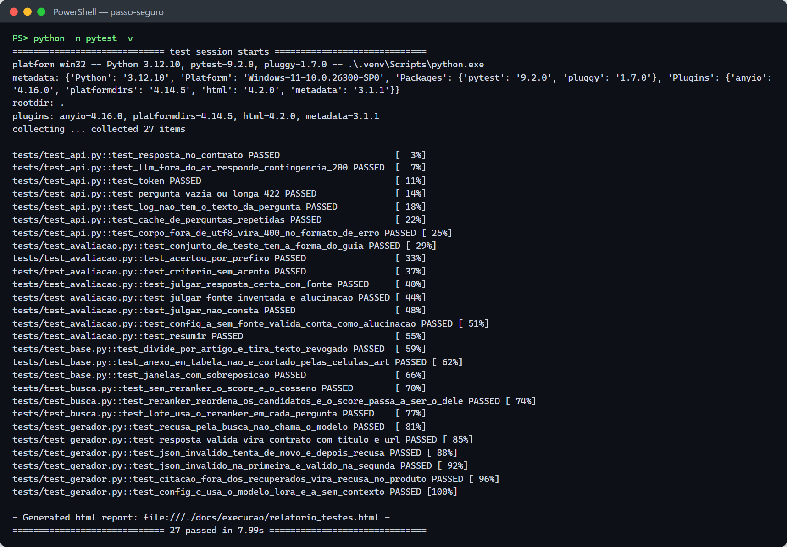

| Arquivo | Teste | O que garante |
|---|---|---|
| `test_api.py` | `test_resposta_no_contrato` | 200 com exatamente `{resposta, fontes, confianca, recusou}`; fonte com `titulo` e `url` |
| | `test_llm_fora_do_ar_responde_contingencia_200` | LLM fora do ar → 200 com recusa e o link do 156 |
| | `test_token` | sem token → 401 |
| | `test_pergunta_vazia_ou_longa_422` | pergunta vazia ou com mais de 500 caracteres → 422 |
| | `test_log_nao_tem_o_texto_da_pergunta` | **privacidade:** o log nunca contém a pergunta |
| | `test_cache_de_perguntas_repetidas` | a mesma pergunta (normalizada) não chama o LLM duas vezes |
| | `test_corpo_fora_de_utf8_vira_400_no_formato_de_erro` | corpo fora de UTF-8 → 400 `{codigo, mensagem}` |
| `test_gerador.py` | `test_recusa_pela_busca_nao_chama_o_modelo` | abaixo do limiar, recusa sem chamar o LLM |
| | `test_resposta_valida_vira_contrato_com_titulo_e_url` | o `trecho_id` vira `{titulo, url}` com o artigo |
| | `test_json_invalido_tenta_de_novo_e_depois_recusa` | dois JSONs inválidos → recusa |
| | `test_json_invalido_na_primeira_e_valido_na_segunda` | a segunda tentativa é aproveitada |
| | `test_citacao_fora_dos_recuperados_vira_recusa_no_produto` | fonte inventada → recusa no contrato |
| | `test_config_c_usa_o_modelo_lora_e_a_sem_contexto` | C usa `passo-seguro-lora`; A não manda trechos |
| `test_busca.py` | `test_sem_reranker_o_score_e_o_cosseno` | sem reranker, o score é o cosseno do e5 |
| | `test_reranker_reordena_os_candidatos_e_o_score_passa_a_ser_o_dele` | o reranker reordena e o limiar vale sobre o score dele |
| | `test_lote_usa_o_reranker_em_cada_pergunta` | a busca em lote (placar) usa o reranker em cada pergunta |
| `test_avaliacao.py` | `test_conjunto_de_teste_tem_a_forma_do_guia` | 60 perguntas, 40 respondíveis, 15 dev |
| | `test_acertou_por_prefixo` | `ctb-art181` casa com `ctb-art181-p2`; aceita alternativas |
| | `test_criterio_sem_acento` | o critério ignora acentos e maiúsculas |
| | `test_julgar_resposta_certa_com_fonte` | resposta certa com fonte certa é exata |
| | `test_julgar_fonte_inventada_e_alucinacao` | fonte fora dos recuperados é alucinação |
| | `test_julgar_nao_consta` | nas "não consta", só a recusa conta como acerto |
| | `test_config_a_sem_fonte_valida_conta_como_alucinacao` | na config A, resposta sem fonte válida é alucinação |
| | `test_resumir` | as taxas do placar são calculadas certo |
| `test_base.py` | `test_divide_por_artigo_e_tira_texto_revogado` | fatia por artigo; texto `<strike>` (revogado) sai |
| | `test_anexo_em_tabela_nao_e_cortado_pelas_celulas_art` | o anexo de multas não é cortado pela célula "Art. 1º" |
| | `test_janelas_com_sobreposicao` | artigos longos viram janelas de até 500 tokens com sobreposição |

**Testes de ponta a ponta** (com o modelo e a base reais), com as saídas em
[`docs/execucao/`](docs/execucao/): API local ([`api_assistente_local.txt`](docs/execucao/api_assistente_local.txt)),
API no container ([`api_assistente_docker.txt`](docs/execucao/api_assistente_docker.txt)), busca
([`04_avaliar_busca_reranker.txt`](docs/execucao/04_avaliar_busca_reranker.txt)), geração no dev
([`05_geracao_B_dev.txt`](docs/execucao/05_geracao_B_dev.txt)) e placar
([`avaliacao/resultados/placar.md`](avaliacao/resultados/placar.md)).

## 9. Registro da execução de 08/11/2026

Tudo o que foi rodado na máquina da seção 4, em ordem. As saídas reais estão em
[`docs/execucao/`](docs/execucao/) e os prints em [`docs/prints/`](docs/prints/).

| Fase | Situação | Resultado |
|---|---|---|
| Ambiente | ✅ | PyTorch + CUDA 13, RTX 4080, Ollama 0.40.15 |
| Base | ✅ | 82 trechos; bug do Anexo Único corrigido |
| Busca | ⚠️ | recall@3 0,775 (meta 0,8) |
| Geração | ✅ | JSON válido em 100% |
| LoRA | ✅ | treinado e importado no Ollama (Q4_K_M via llama.cpp); revisão dos exemplos feita por IA, a conferir |
| Placar | ✅ | A 23% · B 43% · C 40% de exatidão; C escolhida (menos alucinação, mais recusas corretas) |
| Cinco erros | ✅ | causa e correção (configuração B) |
| API | ✅ | local, Docker e imagem completa do Railway (config C) |
| Notebooks | ✅ | 01 a 05 executados e salvos com as saídas |

### 9.1 Ambiente

O índice `cu124` do PyTorch, que o guia indicava, parou no torch 2.6, e a instalação acabava
trocando-o por uma versão só-CPU. O passo de instalação agora usa `cu130`
([`00_ambiente.txt`](docs/execucao/00_ambiente.txt)).

### 9.2 Base: bug do Anexo Único

As 7 fontes ativas baixaram sem bloqueio. O Anexo Único da Lei 15.442, que tem os **valores das
multas**, entrava na base só com o cabeçalho da tabela: a célula "Art. 1º" da coluna
"Dispositivos violados" era lida como início de um artigo novo, e as linhas com R$ 4,00/m²,
R$ 200 e R$ 300 por metro linear se perdiam. Corrigido em `dividir_artigos`
(`src/passo_genai/base.py`), com teste. Depois disso, a exatidão de B subiu de 43% para 50%.

### 9.3 Busca: reranker

Em 8 dos 16 erros do e5, a página genérica `sp-subpref-calcadas` ocupava o top-3, e o trecho
certo vinha logo abaixo (recall@10 = 0,875). O reranker resolve parte disso. O `mmarco-mMiniLMv2`
foi escolhido porque empata com o `bge-reranker-v2-m3` no critério do dev (equilíbrio de 0,8) e é
o único que cabe no prazo de 12 s em CPU. O limiar foi recalibrado no dev de 0,86 (cosseno) para
0,17. O gabarito **não** foi alterado para fechar a meta de 0,8. Saídas:
[`04_avaliar_busca_denso.txt`](docs/execucao/04_avaliar_busca_denso.txt) (antes),
[`04_avaliar_busca_reranker.txt`](docs/execucao/04_avaliar_busca_reranker.txt) (depois).

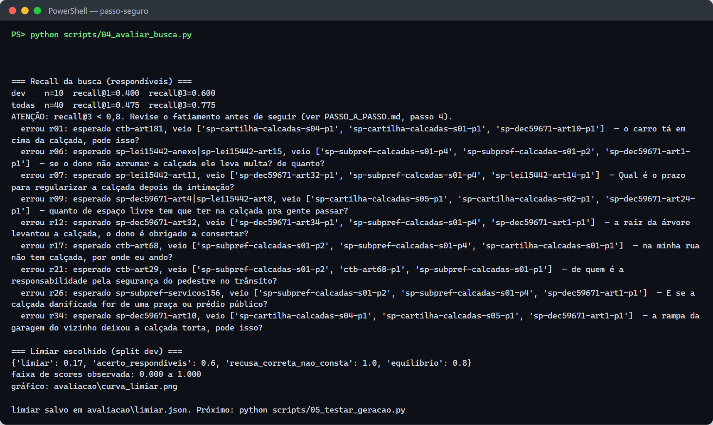

### 9.4 Geração

O JSON veio válido em todas as perguntas dev. A checagem de citação transformou em recusa uma
resposta sem fonte ([`05_geracao_B_pergunta_limiar080.txt`](docs/execucao/05_geracao_B_pergunta_limiar080.txt)).

### 9.5 LoRA

**Exemplos:** duas rodadas do `06` com o professor `qwen2.5:7b-instruct`, juntadas sem repetição
(e5 ≥ 0,95), somaram 435 exemplos. O filtro antivazamento descartou outros 355 candidatos,
parecidos demais com perguntas do teste.

**Revisão:**

> ⚠️ A revisão foi feita pelo **Claude (assistente de IA)**, a pedido da equipe, exemplo a
> exemplo, comparando pergunta, trecho de origem e resposta. O guia pede revisão **à mão**:
> confira antes da entrega. Cada decisão, com o motivo, está em
> [`treino/revisao_ia.json`](treino/revisao_ia.json); os exemplos em `treino/treino_bruto.jsonl`
> levam `revisor: "Claude (IA) - conferir"`.

| | Quantidade |
|---|---|
| Gerados | 435 |
| Aprovados sem mudança | 227 |
| Aprovados com edição | 97 |
| Rejeitados | 111 |
| **No treino** | **324** (28% recusas) |

Rejeitados: valores ou serviços **inventados** pelo professor ("1,50 m", "6,00 m", "juntas de
epóxi"), perguntas sobre o aviso de cookies do site, regras só de motorista, duplicatas,
caracteres quebrados do PDF e recusas para perguntas que a base responde. Editados: nome exato do
serviço do 156, penalidade que faltava e erros de conteúdo (faixa de serviço × faixa de acesso; o
PPUC dispensa de executar, não de manter; quem autoriza bicicleta no passeio).

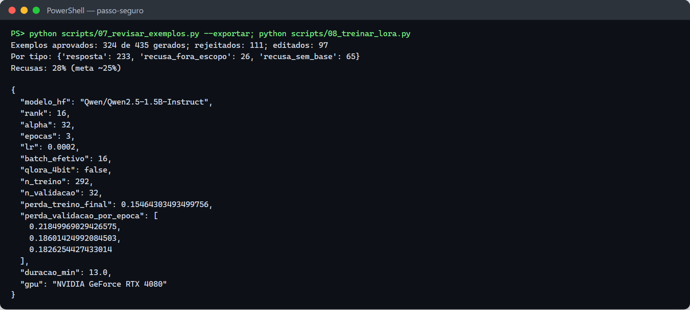

**Treino:** rodado pelo notebook `04_lora.ipynb` (números na seção 3). O `transformers` 5.x
removeu `warmup_ratio`; o `08` agora calcula `warmup_steps`.

**Exportação para o Ollama.** O Ollama 0.40 não aceita mais `--quantize q4_K_M` ao importar
safetensors, e a importação passa pelo motor MLX, que não suporta Qwen2
(`unsupported MLX architecture`). A conversão foi feita com o **llama.cpp oficial** (build
`b12207`, do `ggml-org`):

1. `convert_hf_to_gguf.py modelos/mesclado --outtype f16` → `mesclado-f16.gguf` (3,1 GB);
2. `llama-quantize ... Q4_K_M` → `modelos/passo-seguro-lora-q4_K_M.gguf` (**986 MB**, o mesmo tamanho
   e a mesma quantização do `qwen2.5:1.5b-instruct`, para a comparação no placar ser justa);
3. `ollama create passo-seguro-lora -f modelos/Modelfile.gguf`, com o template de chat do modelo base.

O conversor precisou de `sentencepiece` e `protobuf` (`pip install sentencepiece protobuf`).

### 9.6 API e container

| Ambiente | Evidência |
|---|---|
| Local, config B | [`api_assistente_local.txt`](docs/execucao/api_assistente_local.txt) |
| Docker (`deploy/Dockerfile.api`) | [`api_assistente_docker.txt`](docs/execucao/api_assistente_docker.txt): saúde 200, 401, resposta com CTB art. 70, healthcheck `healthy` |
| Railway (`deploy/Dockerfile.railway`), config C | [`api_assistente_railway.txt`](docs/execucao/api_assistente_railway.txt): Ollama + `passo-seguro-lora` + API num container só, em CPU; ~4 s por resposta |
| Railway, URL pública | [`api_assistente_railway_publico.txt`](docs/execucao/api_assistente_railway_publico.txt): saúde 200, 401 sem token, resposta com fonte em ~7 s, recusa fora do escopo |

- **Imagem de 11,7 GB → 3,96 GB:** o `pip --prefix` puxava o torch CUDA; corrigido com
  `PYTHONPATH` e um `.dockerignore` próprio. Com o reranker embutido, a imagem tem 4,83 GB.
- **Erro fora do contrato:** corpo fora de UTF-8 voltava `{"detail": ...}`; agora volta 400
  `{codigo: "requisicao_invalida", mensagem}`.
- **Imagem do Railway de 15,2 GB → 6,9 GB:** a base `ollama/ollama` traz 4,6 GB de bibliotecas de
  GPU (CUDA 12/13, MLX) que o Railway não usa. O Dockerfile agora copia só o binário e as
  bibliotecas de CPU para uma base Ubuntu 24.04.

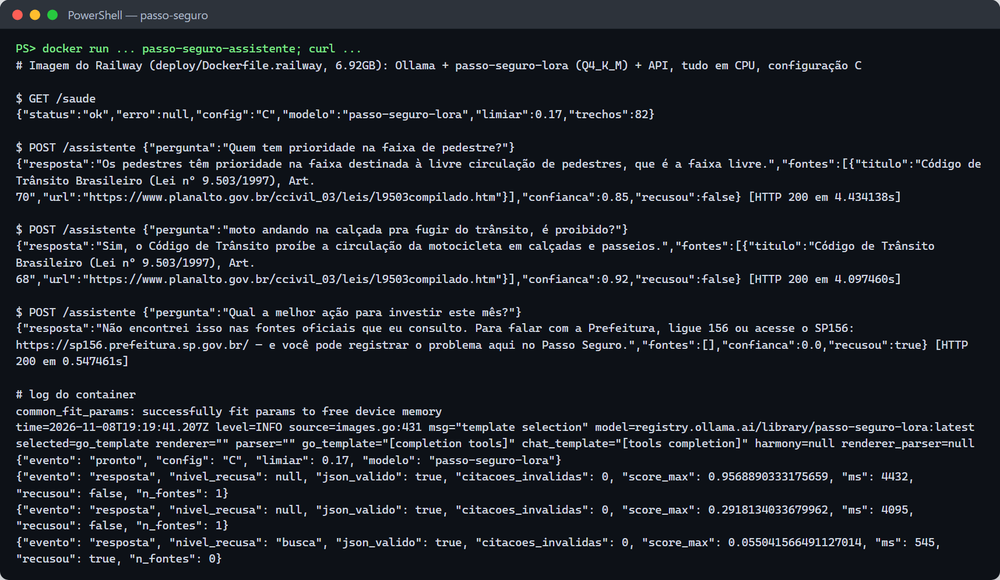

No teste do container do Railway, as respostas mostram os limites atuais de C: na pergunta da faixa
de pedestre, ele misturou a "faixa livre" da calçada com a faixa de travessia; na da moto, acertou
a resposta, mas citou o art. 68 em vez do 193.

## 10. Estrutura do repositório

```
passo-seguro-genai/
├── README.md
├── .env.exemplo              variáveis de ambiente (copie para .env)
│
├── src/passo_genai/          código: base, busca (e5 + reranker), prompts, gerador, avaliacao, esquemas, professor
├── api/                      app.py — FastAPI do POST /assistente
├── scripts/                  00 a 10, na ordem das fases
├── notebooks/                01_base, 02_busca, 03_geracao, 04_lora, 05_placar (com saídas salvas)
├── tests/                    contrato da API, geração, busca, avaliação, fatiamento
│
├── base/                     base de conhecimento: fontes.yaml, brutos/, trechos.jsonl, indice/
├── treino/                   exemplos do LoRA: treino_bruto, treino, revisao_ia.json, estatisticas
├── avaliacao/                teste.jsonl (60 perguntas), criterio.md, avaliar.py, limiar.json
│   └── resultados/           gerados: placar.*, saidas/, cinco_erros.md, erros_candidatos.md, busca.json, curva_limiar.png
├── modelos/                  fora do git: lora-adapter/, mesclado/, *.gguf, Modelfile (só o Modelfile.gguf vai para o git)
│
├── deploy/                   Dockerfile.api, Dockerfile.railway, docker-compose.yml, entrypoint.sh (+ .dockerignore de cada um)
├── requirements/             base.txt (RAG/API), dev.txt (+ testes e notebooks), treino.txt (LoRA), api.txt (imagem Docker)
└── docs/                     relatorio.md, plano-b-agente.md, execucao/ (saídas reais), prints/
```

Os builds Docker usam a raiz do repositório como contexto (`docker build -f deploy/<arquivo> .`);
cada Dockerfile tem o seu `.dockerignore` ao lado (`deploy/<arquivo>.dockerignore`), que deixa
entrar só o que a imagem precisa.

`modelos/` só guarda arquivos gerados: `lora-adapter/` (o adapter, que pode ser publicado no
Hugging Face), `mesclado/` (base + adapter em safetensors, entrada da conversão) e os arquivos do
Ollama (`Modelfile`, `Modelfile.gguf`, `passo-seguro-lora-q4_K_M.gguf`).

## 11. Solução de problemas

| Sintoma | Causa e solução |
|---|---|
| `torch.cuda.is_available()` é `False` com placa NVIDIA | instale o torch pelo índice `cu130` antes dos requirements (seção 5) |
| `01_baixar_base.py` mostra `FALHOU` | salve a página pelo navegador em `base/brutos/<id>.html` e rode de novo |
| `09_exportar_ollama.py`: `unsupported --quantize "q4_K_M"` ou `unsupported MLX architecture` | Ollama 0.40+. Converta com o llama.cpp: `python convert_hf_to_gguf.py modelos/mesclado --outtype f16 --outfile modelos/mesclado-f16.gguf`, depois `llama-quantize modelos/mesclado-f16.gguf modelos/passo-seguro-lora-q4_K_M.gguf Q4_K_M`, e crie o modelo com `FROM ./passo-seguro-lora-q4_K_M.gguf` e o template do base |
| `SFTConfig ... unexpected keyword argument 'warmup_ratio'` | transformers 5.x; já corrigido no `08` |
| API devolve 400 `requisicao_invalida` com acento | o cliente mandou o corpo fora de UTF-8 (comum no `curl.exe`); use `Invoke-RestMethod` ou `--data-binary @arquivo.json` |
| Imagem Docker com mais de 10 GB | confira o `deploy/Dockerfile.api.dockerignore` e o `PYTHONPATH` no estágio `deps` do `deploy/Dockerfile.api` |
| Toda pergunta cai na contingência | `CONFIG_VENCEDORA=C` sem o modelo `passo-seguro-lora` no Ollama: use B ou importe o modelo |

## 12. Links

- Vídeo: _link (pode ser o do pitch)_
- Adapter LoRA: _link do Hugging Face, se publicado_

### Repositórios do projeto
- Principal: [passo-seguro](https://github.com/Passo-Seguro/passo-seguro)
- GenAI: [passo-seguro-genai](https://github.com/Passo-Seguro/passo-seguro-genai) · Dados: [passo-seguro-dados](https://github.com/Passo-Seguro/passo-seguro-dados) · Visão: [passo-seguro-visao](https://github.com/Passo-Seguro/passo-seguro-visao) · RPA: [passo-seguro-rpa](https://github.com/Passo-Seguro/passo-seguro-rpa) · Robô: [passo-seguro-robo](https://github.com/Passo-Seguro/passo-seguro-robo)
