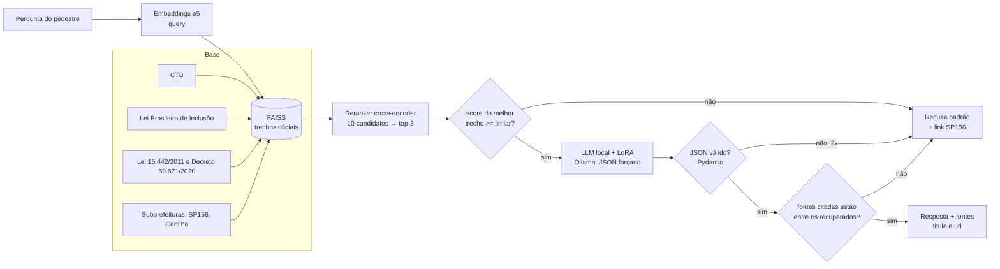

# Passo Seguro — Generative AI for Engineering

Assistente do pedestre: um LLM local pequeno especializado com **RAG + LoRA**, que responde
dúvidas sobre calçadas, travessias e como reclamar em São Paulo **citando a lei ou a página
oficial**, e que **recusa** quando a resposta não está na base.

Ficha Técnica: [README do repositório principal](https://github.com/Passo-Seguro/passo-seguro#ficha-técnica)

## Integrantes
| Nome completo | RM |
|---|---|
| Guilherme Morais | 551981 |
| Júlia Marques | 98680 |
| Matheus Gusmão | 550826 |

## Ficha Técnica: o que a IA resolve

| Campo | |
|---|---|
| Tarefa | Responder dúvidas de pedestres de São Paulo sobre calçadas, travessias e como reclamar, citando a fonte, em JSON. |
| Por que importa | Reclamar de calçada hoje é confuso: o pedestre não sabe se o problema é do dono do imóvel, da Prefeitura ou de uma concessionária, nem qual serviço do 156 usar. |
| Modelo | Qwen2.5-1.5B-Instruct (Apache 2.0), quantizado em q4_K_M, rodando no Ollama |
| Especialização | LoRA (rank 16, alpha 32) com 324 exemplos (28% recusas), revisados exemplo a exemplo (revisão feita por IA, a conferir: ver `treino/revisao_ia.json`) |
| Busca | `intfloat/multilingual-e5-base` + FAISS (10 candidatos) → reranker `mmarco-mMiniLMv2` → top-3; limiar 0,17 escolhido no dev pela curva acerto × recusa |
| Saída | JSON validado (Pydantic): `{"resposta", "fontes", "confianca", "recusou"}` |
| Integração | `POST /assistente`, consumido pelo app (PWA) via API principal |
| IA responsável | O app sempre mostra as fontes; sem base, recusa e aponta o SP156; as perguntas não são guardadas com dados pessoais; o viés com linguagem informal é medido no placar |

## Pipeline



## Base de conhecimento

> Gerada por `scripts/02_fatiar.py` em [`base/tabela_base.md`](base/tabela_base.md).

| Fonte | Formato | Licença | Trechos |
|---|---|---|---|
| Código de Trânsito Brasileiro (Lei 9.503/1997) | HTML | Ato oficial (domínio público) | 18 |
| Lei Brasileira de Inclusão (Lei 13.146/2015) | HTML | Ato oficial (domínio público) | 11 |
| Lei municipal 15.442/2011 | HTML | Ato oficial (domínio público) | 11 |
| Decreto municipal 59.671/2020 | HTML | Ato oficial (domínio público) | 16 |
| Subprefeituras: calçadas e serviços do 156 | HTML | Publicação oficial da Prefeitura | 10 |
| Cartilha de Calçadas 2023 (SMPED) | PDF | Publicação oficial da Prefeitura | 16 |
| **Total** | | | **82** |

A NBR 9050 fica fora da base: é norma da ABNT, protegida por direito autoral.

## Performance: as três configurações

> Preenchido por `avaliacao/avaliar.py` ([`avaliacao/placar.md`](avaliacao/placar.md)), nas 45 perguntas de teste.
> O critério está em [`avaliacao/criterio.md`](avaliacao/criterio.md).

| Configuração | Exatidão | Alucinação | Recusa correta (não consta) | Recusa indevida | JSON válido | Latência |
|---|---|---|---|---|---|---|
| A — modelo sem contexto | 23% | 100% | 0% | 0% | 100% | 0,29 s |
| B — RAG simples | 50% | 29% | 80% | 20% | 100% | 0,32 s |
| C — RAG + LoRA | pendente | | | | | |

C está pendente: o LoRA foi treinado (perda de validação 0,218 → 0,183), mas o Ollama 0.40 não
importa o modelo Qwen2 em safetensors, e falta a conversão para GGUF com o llama.cpp. Ver
[`docs/execucao/README.md`](docs/execucao/README.md#5d-exportação-para-o-ollama-09_exportar_ollamapy-bloqueada).

Formal × informal ([`avaliacao/placar_por_registro.csv`](avaliacao/placar_por_registro.csv)):
na configuração B, 67% de exatidão nas formais e 39% nas informais; as recusas indevidas
aparecem só nas informais (33%).

> ⚠️ Na configuração B, "carro na calçada pode?" recebe uma resposta **errada** ("Sim, o carro
> pode estar na calçada…"). Detalhes no [registro de execução](docs/execucao/README.md#8-api).
Os cinco erros reais estão em [`avaliacao/cinco_erros.md`](avaliacao/cinco_erros.md).

## Como reproduzir

O passo a passo completo, no VS Code e com treino na sua GPU, está em
**[PASSO_A_PASSO.md](PASSO_A_PASSO.md)**. Resumo:

```bash
pip install torch --index-url https://download.pytorch.org/whl/cu130
pip install -r requirements-dev.txt -r requirements-treino.txt
ollama pull qwen2.5:1.5b-instruct
python scripts/01_baixar_base.py && python scripts/02_fatiar.py      # Fase 2
python scripts/03_indexar.py && python scripts/04_avaliar_busca.py   # Fase 3
python scripts/05_testar_geracao.py                                  # Fase 4
python scripts/06_gerar_exemplos.py && python scripts/07_revisar_exemplos.py && python scripts/07_revisar_exemplos.py --exportar
python scripts/08_treinar_lora.py && python scripts/09_exportar_ollama.py   # Fase 5 (GPU)
python avaliacao/avaliar.py                                          # Fase 6: placar
python scripts/10_erros.py                                           # Fase 7
```

## Estrutura

```
notebooks/   01_base, 02_busca, 03_geracao, 04_lora, 05_placar (com saídas salvas)
base/        fontes.yaml, brutos/ (textos oficiais + URL e data de acesso), trechos.jsonl, indice/
avaliacao/   teste.jsonl (60 perguntas), criterio.md, avaliar.py, placar.*, saidas/, cinco_erros.md
treino/      treino_bruto.jsonl (gerado), treino.jsonl (revisado), estatisticas.md
src/passo_genai/  base, busca, prompts, gerador, avaliacao, esquemas, professor
scripts/     00 a 10, na ordem das fases
api/         FastAPI do POST /assistente, Dockerfile, entrypoint do Railway
tests/       contrato da API, geração (recusa, JSON, citação), avaliação, fatiamento
docs/        GUIA_DE_USO, TESTES, execucao/ (saídas reais), prints/, relatório e plano B (agente)
```

## Documentação

- [Guia de uso da API](docs/GUIA_DE_USO.md): contrato, exemplos em curl, PowerShell, Python e JS, erros e configuração
- [Testes](docs/TESTES.md): o que cada um dos 27 testes garante e como rodar
- [Registro de execução](docs/execucao/README.md): tudo o que foi rodado, com números, problemas e correções
- [Prints](docs/prints/): testes, Swagger, chamadas da API, curva do limiar, perda do LoRA, placar

## Links

- Vídeo: _link (pode ser o do pitch)_
- Adapter LoRA: _link do Hugging Face, se publicado_

## Repositórios do projeto
- Principal: [passo-seguro](https://github.com/Passo-Seguro/passo-seguro)
- GenAI: [passo-seguro-genai](https://github.com/Passo-Seguro/passo-seguro-genai) · Dados: [passo-seguro-dados](https://github.com/Passo-Seguro/passo-seguro-dados) · Visão: [passo-seguro-visao](https://github.com/Passo-Seguro/passo-seguro-visao) · RPA: [passo-seguro-rpa](https://github.com/Passo-Seguro/passo-seguro-rpa) · Robô: [passo-seguro-robo](https://github.com/Passo-Seguro/passo-seguro-robo)
