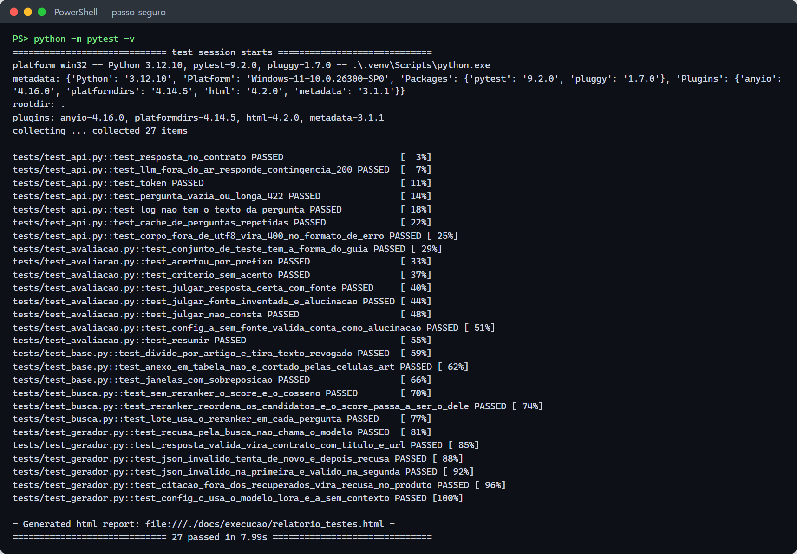

# Testes

Há duas camadas de teste:

1. **Testes automatizados (`pytest`)**: conferem o código sem rede, sem GPU e sem o Ollama. Os
   embeddings e o LLM são substituídos por versões falsas e determinísticas, definidas em
   [`tests/conftest.py`](../tests/conftest.py). Rodam em menos de 15 s.
2. **Avaliação do modelo**: a busca (`04_avaliar_busca.py`), a geração no dev
   (`05_testar_geracao.py`) e o placar A/B/C nas 45 perguntas de teste (`avaliacao/avaliar.py`).
   Os resultados estão no [README](../README.md#performance-as-três-configurações) e em
   [`execucao/`](execucao/).

## Como rodar

```powershell
.venv\Scripts\Activate.ps1
python -m pytest -v                                    # todos
python -m pytest tests/test_api.py -v                  # um arquivo
python -m pytest -k recusa -v                          # pelo nome
python -m pytest --html=docs/execucao/relatorio_testes.html --self-contained-html   # relatório HTML
```

No VS Code: aba **Testing** (ícone de béquer), que já vem configurada em `.vscode/settings.json`.

## Resultado da última execução

**27 testes, 27 passaram** (08/11/2026, Python 3.12.10, Windows 11). Saída completa em
[`execucao/pytest.txt`](execucao/pytest.txt) e relatório em
[`execucao/relatorio_testes.html`](execucao/relatorio_testes.html).



## O que cada teste confere

### Contrato da API — [`tests/test_api.py`](../tests/test_api.py)

| Teste | O que garante |
|---|---|
| `test_resposta_no_contrato` | 200 com exatamente `{resposta, fontes, confianca, recusou}`; fonte com `titulo` e `url`; confiança entre 0 e 1 |
| `test_llm_fora_do_ar_responde_contingencia_200` | se o LLM cai ou estoura o tempo, a resposta é 200 com recusa e o link do 156 (a API principal nunca recebe 500) |
| `test_token` | sem `Authorization` → 401 |
| `test_pergunta_vazia_ou_longa_422` | pergunta vazia ou com mais de 500 caracteres → 422 `dados_invalidos` |
| `test_log_nao_tem_o_texto_da_pergunta` | **privacidade**: o log nunca contém o texto da pergunta |
| `test_cache_de_perguntas_repetidas` | a mesma pergunta (normalizada) não chama o LLM duas vezes |
| `test_corpo_fora_de_utf8_vira_400_no_formato_de_erro` | corpo que não decodifica em UTF-8 → 400 `requisicao_invalida`, no formato `{codigo, mensagem}` |

### Geração fundamentada — [`tests/test_gerador.py`](../tests/test_gerador.py)

| Teste | O que garante |
|---|---|
| `test_recusa_pela_busca_nao_chama_o_modelo` | abaixo do limiar, recusa **sem** chamar o LLM (primeiro nível de recusa) |
| `test_resposta_valida_vira_contrato_com_titulo_e_url` | o `trecho_id` citado vira `{titulo, url}` com o artigo; o prompt leva os trechos com o id |
| `test_json_invalido_tenta_de_novo_e_depois_recusa` | dois JSONs inválidos seguidos → recusa com `nivel_recusa = "json"` |
| `test_json_invalido_na_primeira_e_valido_na_segunda` | a segunda tentativa é aproveitada |
| `test_citacao_fora_dos_recuperados_vira_recusa_no_produto` | fonte inventada é marcada como citação inválida e, no contrato, vira recusa |
| `test_config_c_usa_o_modelo_lora_e_a_sem_contexto` | C usa `passo-seguro-lora`; A não manda trechos ao modelo |

### Busca e reranker — [`tests/test_busca.py`](../tests/test_busca.py)

| Teste | O que garante |
|---|---|
| `test_sem_reranker_o_score_e_o_cosseno` | sem reranker, o score é o cosseno do e5 |
| `test_reranker_reordena_os_candidatos_e_o_score_passa_a_ser_o_dele` | o reranker reordena os candidatos e o limiar passa a valer sobre o score dele |
| `test_lote_usa_o_reranker_em_cada_pergunta` | a busca em lote (usada no placar) aplica o reranker pergunta a pergunta |

### Avaliação — [`tests/test_avaliacao.py`](../tests/test_avaliacao.py)

| Teste | O que garante |
|---|---|
| `test_conjunto_de_teste_tem_a_forma_do_guia` | `teste.jsonl` tem 60 perguntas: 40 respondíveis e 20 "não consta", 15 dev e 45 teste |
| `test_acertou_por_prefixo` | `ctb-art181` casa com `ctb-art181-p2`; aceita alternativas com `|` |
| `test_criterio_sem_acento` | o critério de acerto ignora acentos e maiúsculas |
| `test_julgar_resposta_certa_com_fonte` | resposta certa com a fonte certa conta como exata |
| `test_julgar_fonte_inventada_e_alucinacao` | fonte fora dos recuperados conta como alucinação |
| `test_julgar_nao_consta` | nas "não consta", só a recusa conta como acerto |
| `test_config_a_sem_fonte_valida_conta_como_alucinacao` | na config A (sem contexto), resposta sem fonte válida é alucinação |
| `test_resumir` | as taxas do placar são calculadas certo |

### Base de conhecimento — [`tests/test_base.py`](../tests/test_base.py)

| Teste | O que garante |
|---|---|
| `test_divide_por_artigo_e_tira_texto_revogado` | lei fatiada por artigo; texto `<strike>` (revogado) sai; parágrafos ficam no artigo; preâmbulo descartado |
| `test_anexo_em_tabela_nao_e_cortado_pelas_celulas_art` | o anexo em tabela não é cortado pela célula "Art. 1º" (bug que tirava os valores das multas da base) e termina no rodapé do portal |
| `test_janelas_com_sobreposicao` | artigos longos viram janelas de até 500 tokens com sobreposição |

## Testes de ponta a ponta (manuais, com o modelo de verdade)

Rodados com o Ollama e a base real; as saídas estão em [`execucao/`](execucao/).

| Cenário | Como reproduzir | Evidência |
|---|---|---|
| API local: saúde, 401, 422, resposta com fonte, recusa, cache, log | `uvicorn api.app:app --port 8002` + curl | [`api_assistente_local.txt`](execucao/api_assistente_local.txt) |
| API no container | `docker build -f api/Dockerfile ...` + `docker run` | [`api_assistente_docker.txt`](execucao/api_assistente_docker.txt) |
| Busca: recall e limiar | `python scripts/04_avaliar_busca.py` | [`04_avaliar_busca_reranker.txt`](execucao/04_avaliar_busca_reranker.txt) |
| Geração no dev | `python scripts/05_testar_geracao.py --config B` | [`05_geracao_B_dev.txt`](execucao/05_geracao_B_dev.txt) |
| Placar A/B/C | `python avaliacao/avaliar.py` | [`avaliacao/placar.md`](../avaliacao/placar.md) |
