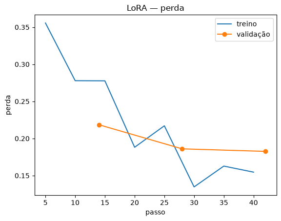

# Registro de execução — 08/11/2026

O que foi rodado nesta máquina, em ordem, com as saídas reais salvas nesta pasta e os prints em
[`../prints/`](../prints/). O guia de uso está em [`../GUIA_DE_USO.md`](../GUIA_DE_USO.md) e os
testes em [`../TESTES.md`](../TESTES.md).

## Resumo

| Fase | Situação | Resultado principal |
|---|---|---|
| 1. Ambiente | ✅ | Python 3.12, PyTorch 2.14.1 + CUDA 13.0, RTX 4080, Ollama 0.40.15 |
| 2. Base | ✅ | 7 fontes, 82 trechos; **bug no fatiamento do Anexo Único corrigido** |
| 3. Busca | ⚠️ | reranker adicionado: recall@3 de 0,60 para **0,775** (meta 0,8) |
| 4. Geração | ✅ | JSON válido em 100%; recusa em dois níveis funcionando |
| 5. LoRA | ⚠️ | 435 exemplos gerados, **revisados por IA** (324 aprovados); LoRA treinado; **não importado no Ollama** |
| 6. Placar | ⚠️ | A e B nas 45 perguntas de teste; **C pendente** (depende da fase 5) |
| 7. Cinco erros | ✅ | [`avaliacao/cinco_erros.md`](../../avaliacao/cinco_erros.md), com causa e correção (configuração B) |
| 8. API | ✅ | local e Docker testados; saúde, 401, 400, 422, cache, log sem a pergunta |
| Notebooks | ✅ | 01 a 04 executados e salvos com as saídas; o 05 depende da configuração C |
| Testes | ✅ | **27 de 27** passando |

## 1. Ambiente

| Item | Versão |
|---|---|
| Sistema | Windows 11 Pro |
| Python | 3.12.10 (venv em `.venv`) |
| GPU | NVIDIA GeForce RTX 4080, 16 GB, driver 617.14, CUDA 13.0, bf16 |
| PyTorch | 2.14.1+cu130 |
| transformers / peft / trl | 5.22.2 / 0.21.2 / 1.17.1 |
| Ollama | 0.40.15: `qwen2.5:1.5b-instruct` (base), `qwen2.5:7b-instruct` (professor) |
| Embeddings / reranker | `intfloat/multilingual-e5-base` / `cross-encoder/mmarco-mMiniLMv2-L12-H384-v1` |

Saída: [`00_ambiente.txt`](00_ambiente.txt).

## 2. Base de conhecimento

`01_baixar_base.py` baixou as 7 fontes ativas sem bloqueio do Planalto. As 4 páginas do SP156
seguem `ativo: false` porque as URLs não foram preenchidas. `02_fatiar.py` gerou **82 trechos**, e
todo `trecho_id` do gabarito existe na base ([`base/tabela_base.md`](../../base/tabela_base.md)).

**Bug encontrado e corrigido.** O Anexo Único da Lei 15.442, que tem os **valores das multas**,
entrava na base só com o cabeçalho da tabela. A célula "Art. 1º" da coluna "Dispositivos
violados" era lida como início de um artigo novo, e as linhas com R$ 4,00/m², R$ 200, R$ 300 por
metro linear etc. se perdiam. A correção está em `dividir_artigos` (`src/passo_genai/base.py`): o
anexo não é mais cortado por células "Art." e termina no rodapé do portal. O teste é
`test_anexo_em_tabela_nao_e_cortado_pelas_celulas_art`. Depois da correção, a exatidão da
configuração B no placar subiu de 43% para 50%.

## 3. Busca

| Configuração | recall@1 (dev) | recall@3 (dev) | recall@1 (40) | recall@3 (40) | s/pergunta (CPU) |
|---|---|---|---|---|---|
| só e5 (original) | 0,20 | 0,20 | 0,30 | 0,60 | 0,01 |
| e5 + `mmarco-mMiniLMv2` (**adotado**) | 0,40 | 0,60 | 0,475 | **0,775** | ~1,1 |
| e5 + `bge-reranker-v2-m3` | 0,50 | 0,60 | 0,625 | 0,80 | ~11,5 |

- **Por que um reranker:** em 8 dos 16 erros do e5, a página genérica `sp-subpref-calcadas`
  ocupava o top-3, e o trecho certo vinha logo abaixo (recall@10 = 0,875). O e5 traz 10
  candidatos, o cross-encoder relê cada par pergunta–trecho e os 3 melhores vão para o prompt.
- **Por que o mMiniLM, e não o bge:** no dev os dois empatam no critério do guia (equilíbrio do
  limiar de 0,8). O bge leva cerca de 11,5 s por pergunta em CPU e sozinho estoura o prazo de 12 s
  da API. A decisão usou só o dev e o requisito de latência, nunca o teste.
- **Limiar:** recalibrado no dev sobre o score do reranker, de 0,86 (cosseno) para **0,17**. Com
  ele, o dev fica com acerto de 0,6 nas respondíveis e recusa correta de 1,0 nas "não consta"
  ([`../prints/06_curva_limiar_reranker.png`](../prints/06_curva_limiar_reranker.png)).
- A meta de 0,8 não foi atingida com o modelo de CPU. O gabarito **não** foi alterado para
  fechar a conta.

Saídas: [`04_avaliar_busca_denso.txt`](04_avaliar_busca_denso.txt) (antes),
[`04_avaliar_busca_reranker.txt`](04_avaliar_busca_reranker.txt) (depois),
[`curva_limiar_denso.png`](curva_limiar_denso.png).

## 4. Geração

`05_testar_geracao.py --config B` nas 15 perguntas dev ([`05_geracao_B_dev.txt`](05_geracao_B_dev.txt),
execução com a busca antiga). O JSON veio válido em todas. A checagem de citação transformou em
recusa uma resposta sem fonte ([`05_geracao_B_pergunta_limiar080.txt`](05_geracao_B_pergunta_limiar080.txt)).

## 5. LoRA

### 5a. Exemplos (`06_gerar_exemplos.py`)

O professor foi o `qwen2.5:7b-instruct` local. Rodaram duas rodadas (`--alvo 300`, e depois
`--por-trecho 3 --semente 7`), juntadas sem repetição (e5 ≥ 0,95): **435 exemplos**. O filtro
antivazamento (similaridade ≥ 0,90 com qualquer pergunta do teste) descartou 355 candidatos.

### 5b. Revisão (`07_revisar_exemplos.py`)

> **Atenção:** a revisão foi feita pelo **Claude (assistente de IA)**, a pedido da equipe,
> exemplo a exemplo, comparando pergunta, trecho de origem e resposta. O guia pede revisão **à
> mão**: confira antes da entrega. Cada decisão, com o motivo, está em
> [`treino/revisao_ia.json`](../../treino/revisao_ia.json), e os exemplos em
> `treino/treino_bruto.jsonl` levam `revisor: "Claude (IA) - conferir"`.

| | Quantidade |
|---|---|
| Gerados | 435 |
| Aprovados sem mudança | 227 |
| Aprovados com edição | 97 |
| Rejeitados | 111 |
| **No treino** | **324** (233 respostas, 26 recusas fora de escopo, 65 recusas sem base: 28% de recusas) |

Principais motivos de rejeição: valores ou serviços **inventados** pelo professor (ex.: "1,50 m",
"6,00 m", "juntas de epóxi"); perguntas sobre o aviso de cookies do site; regras só de motorista e
competências administrativas do CTB; duplicatas; caracteres quebrados do PDF; e recusas para
perguntas que a base responde. Edições comuns: nome exato do serviço do 156, penalidade que
faltava e **erros de conteúdo** (faixa de serviço × faixa de acesso; o PPUC dispensa de executar,
não de manter; quem autoriza bicicleta no passeio).

### 5c. Treino (`08_treinar_lora.py`, pelo notebook `04_lora.ipynb`)

| Item | Valor |
|---|---|
| Modelo | Qwen/Qwen2.5-1.5B-Instruct, bf16, sem QLoRA |
| LoRA | rank 16, alpha 32, dropout 0,05, todas as projeções |
| Treino / validação | 292 / 32 exemplos, 3 épocas, batch efetivo 16, lr 2e-4 cosseno |
| Perda de validação por época | 0,218 → 0,186 → 0,183 (sem sobreajuste) |
| Duração | 13 min na RTX 4080, dividindo a GPU com o YOLO |

**Correção no script:** o `transformers` 5.x removeu `warmup_ratio`. O `08` agora calcula
`warmup_steps` (5% dos passos).

### 5d. Exportação para o Ollama (`09_exportar_ollama.py`): **bloqueada**

O Ollama 0.40 mudou a importação de safetensors:

- `--quantize q4_K_M` não existe mais (só `int4`, `int8`, `nvfp4`, `mxfp4`, `mxfp8`);
- a importação passa pelo motor MLX, que **não suporta a arquitetura Qwen2**
  (`unsupported MLX architecture: model "Qwen2ForCausalLM"`), com ou sem quantização.

O único caminho é o que o próprio script documenta: converter com o llama.cpp
(`convert_hf_to_gguf.py` + `llama-quantize ... Q4_K_M`) e criar o modelo a partir do `.gguf`. Essa
etapa **não foi executada** porque exige baixar e rodar código externo (o llama.cpp), o que precisa
da autorização da equipe. O modelo mesclado está em `modelos/mesclado/` (fora do git), pronto para
a conversão. O `09` ganhou `--quantize` para versões do Ollama em que isso funcione.

## 6. Placar (`avaliacao/avaliar.py --configs A B`)

| Configuração | Exatidão | Citação correta | Alucinação | Recusa correta (não consta) | Recusa indevida | JSON válido | Latência |
|---|---|---|---|---|---|---|---|
| A — modelo sem contexto | 23% | 0% | 100% | 0% | 0% | 100% | 0,29 s |
| B — RAG simples | **50%** | 67% | **29%** | 80% | 20% | 100% | 0,32 s |

| Registro | A exatidão | B exatidão | B recusa indevida |
|---|---|---|---|
| formal (17) | 33% | 67% | 0% |
| informal (28) | 17% | 39% | 33% |

- **RAG (A → B):** a exatidão mais que dobra e a alucinação cai de 100% para 29%. Sem contexto, o
  modelo nunca cita fonte válida, então toda resposta de A conta como alucinação. O custo do RAG
  são 20% de recusas indevidas.
- **Viés de registro:** B acerta 67% das perguntas formais e 39% das informais. As recusas
  indevidas aparecem **só** nas informais (33%): o reranker dá notas baixas a "tá", "pra" e
  "a gente". É o maior ponto de melhoria e afeta justamente o público do app.
- **Configuração C:** pendente da exportação (5d). O notebook `05_placar.ipynb` roda A, B e C e
  deve ser executado depois.

Saídas: [`avaliacao/placar.md`](../../avaliacao/placar.md), `placar.csv`,
`placar_por_registro.csv`, `saidas/A.jsonl`, `saidas/B.jsonl`, `revisao_manual.csv`.

## 7. Cinco erros

Em [`avaliacao/cinco_erros.md`](../../avaliacao/cinco_erros.md): resposta sem a penalidade e com
citação em bloco; valor de multa inventado (que revelou o bug do anexo); recusa por limiar em
pergunta informal; alucinação em "não consta" que passou do limiar; vocabulário sem nada em comum
com a base ("empresa de água" × "concessionária").

## 8. API

| Ambiente | Evidência |
|---|---|
| Local (`uvicorn`, config B) | [`api_assistente_local.txt`](api_assistente_local.txt), [print](../prints/04_api_assistente_curl.png), [Swagger](../prints/03_swagger_assistente.png) |
| Docker (`api/Dockerfile`) | [`api_assistente_docker.txt`](api_assistente_docker.txt): saúde 200, 401, resposta com CTB art. 70, healthcheck `healthy` |

Correções feitas na API e na imagem:

- **Imagem de 11,7 GB → 3,96 GB:** o `pip --prefix` puxava o torch CUDA; foi corrigido com
  `PYTHONPATH` e um `.dockerignore`. Com o reranker embutido, a imagem tem **4,83 GB**.
- **Erro fora do contrato:** corpo que não decodifica em UTF-8 voltava `{"detail": ...}`. Agora
  volta 400 `{codigo: "requisicao_invalida", mensagem}`.

> ⚠️ **Falha grave observada:** na configuração B, "carro na calçada pode?" recebe "Sim, o carro
> pode estar na calçada…". É o oposto do CTB (arts. 181 e 193). A busca trouxe a cartilha e o
> art. 68 no lugar do art. 181, e o modelo base inventou a permissão. **Não coloque a configuração
> B em produção sem resolver isso.** O LoRA (C) foi treinado justamente para citar só o que o
> trecho sustenta; confira essa pergunta no placar de C.

## Como repetir

Siga o [PASSO_A_PASSO.md](../../PASSO_A_PASSO.md). Os comandos exatos desta execução estão no topo
de cada arquivo `.txt` desta pasta e nos prints.
