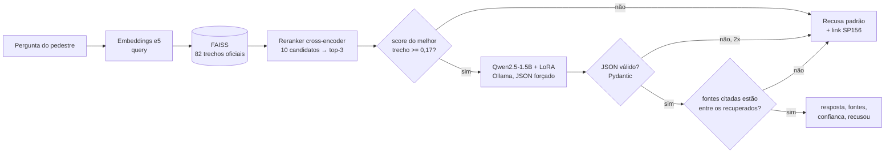
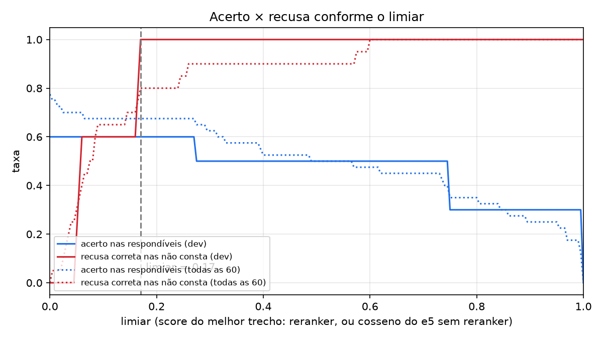

# Relatório — Assistente do pedestre (Generative AI for Engineering)

**Repositório:** https://github.com/Passo-Seguro/passo-seguro-genai ·
**API no ar:** https://assistente-production-307b.up.railway.app ([como usar](../README.md#61-api-no-ar-railway)) ·
**Vídeo:** [link do vídeo]

## 01. Integrantes

Guilherme Morais (RM 551981) · Júlia Marques (RM 98680) · Matheus Gusmão (RM 550826)

## 02. Ficha Técnica: o que a IA resolve

**Tarefa:** responder dúvidas de pedestres de São Paulo sobre calçadas, travessias e como
reclamar, citando a fonte, em JSON.

**Problema.** As solicitações de calçada no SP156 cresceram mais de 200% entre 2020 e 2025 e
chegaram a 49.215 (levantamento apresentado na Câmara Municipal de São Paulo, agosto de 2026).
Mesmo assim, o pedestre não sabe se o conserto é do dono do imóvel, da Prefeitura ou de uma
concessionária, nem qual serviço do 156 pedir. As respostas existem, mas estão espalhadas entre
o CTB, leis e decretos municipais e páginas da Prefeitura.

**Para quem:** idosos, pessoas com deficiência ou mobilidade reduzida, quem empurra carrinho de
bebê: quem mais sofre com a calçada ruim. **Restrição da disciplina:** mobilidade e segurança.

**Solução:** um LLM local pequeno (Qwen2.5-1.5B-Instruct, Apache 2.0) com RAG sobre 82 trechos de
fontes oficiais e especializado com LoRA. Ele responde em linguagem simples, **sempre cita a lei
ou a página de onde tirou a resposta** e **recusa** quando a base não sustenta a resposta,
indicando o SP156. O app (PWA) chama o assistente pela API principal, em `POST /assistente`.

## 03. Pipeline

A pergunta vira um vetor (`intfloat/multilingual-e5-base`), e o FAISS traz os 10 trechos mais
parecidos. O reranker `cross-encoder/mmarco-mMiniLMv2-L12-H384-v1` relê cada par pergunta–trecho
e fica com os 3 melhores. Se o melhor tiver score abaixo do limiar, o serviço **recusa sem chamar
o LLM**. Senão, o modelo responde só com base nos trechos, com a saída presa a um schema JSON. O
Pydantic valida o JSON (uma nova tentativa e, se falhar de novo, recusa), e a checagem de citação
descarta fontes que não estavam entre os trechos recuperados; sem nenhuma fonte válida, a
resposta vira recusa. O contrato final é `{resposta, fontes: [{titulo, url}], confianca, recusou}`.

## 04. Base de conhecimento

| Fonte | Formato | Licença | Trechos | Acesso |
|---|---|---|---|---|
| [Código de Trânsito Brasileiro (Lei nº 9.503/1997)](https://www.planalto.gov.br/ccivil_03/leis/l9503compilado.htm) | HTML | ato oficial, domínio público (Lei 9.610/98, art. 8º, IV) | 18 | 08/11/2026 |
| [Lei Brasileira de Inclusão (Lei nº 13.146/2015)](https://www.planalto.gov.br/ccivil_03/_ato2015-2018/2015/lei/l13146.htm) | HTML | ato oficial, domínio público | 11 | 08/11/2026 |
| [Lei municipal nº 15.442/2011 (limpeza de imóveis e passeios), com alterações](http://legislacao.prefeitura.sp.gov.br/leis/lei-15442-de-09-de-setembro-de-2011) | HTML | ato oficial, domínio público | 11 | 08/11/2026 |
| [Decreto municipal nº 59.671/2020 (padronização das calçadas)](http://legislacao.prefeitura.sp.gov.br/leis/decreto-59671-de-7-de-agosto-de-2020) | HTML | ato oficial, domínio público | 16 | 08/11/2026 |
| [Subprefeituras — Calçadas: o direito de ir e vir…](https://prefeitura.sp.gov.br/subprefeituras/w/noticias/36935) | HTML | publicação oficial da Prefeitura; fonte citada | 6 | 08/11/2026 |
| [Subprefeituras — Serviços do Portal 156](https://prefeitura.sp.gov.br/web/subprefeituras/w/pracas_de_atendimento/335674) | HTML | publicação oficial da Prefeitura; fonte citada | 4 | 08/11/2026 |
| [Cartilha de Calçadas 2023 (SMPED/CPA)](https://www.prefeitura.sp.gov.br/cidade/secretarias/upload/pessoa_com_deficiencia/2023_08_11%20-%20Livreto%20Cartilha%20de%20Cal%C3%A7adas%202023%20-%20Vrs%20NOVA%20NORMA%20-%20V9.pdf) | PDF | publicação oficial da Prefeitura; fonte citada | 16 | 08/11/2026 |
| **Total** | | | **82** | |

Fatiamento: leis por artigo e páginas por seção, com 300 a 500 tokens e sobreposição de 50.
Removemos a redação revogada (texto riscado no Planalto). A NBR 9050 ficou de fora por direitos
autorais.

O fatiamento tinha um bug, achado na análise de erros (seção 06): o **Anexo Único da Lei
15.442**, que tem os valores das multas, entrava só com o cabeçalho da tabela. A célula "Art. 1º"
da coluna "Dispositivos violados" era lida como início de um artigo novo, e as linhas com
R$ 4,00/m², R$ 200 e R$ 300 por metro linear se perdiam. Corrigimos em `dividir_artigos`, com
teste automatizado.

**Busca:** recall@1 = **0,475** e recall@3 = **0,775** nas 40 respondíveis, com o reranker. Só com
o e5, o recall@3 era 0,60: em 8 dos 16 erros, uma página genérica da Subprefeitura ocupava o
top-3, e o trecho certo vinha logo abaixo (recall@10 = 0,875). Por isso adicionamos o reranker,
em vez de mexer de novo nos trechos.

| Busca | recall@1 (40) | recall@3 (40) | s/pergunta em CPU |
|---|---|---|---|
| só e5 | 0,30 | 0,60 | 0,01 |
| e5 + `mmarco-mMiniLMv2` (**adotado**) | 0,475 | **0,775** | ~1,1 |
| e5 + `bge-reranker-v2-m3` | 0,625 | 0,80 | ~11,5 |

O `bge-reranker-v2-m3` chega a 0,80, mas leva 11,5 s por pergunta em CPU e estoura o prazo de
12 s da API. O `mmarco` empata com ele no critério do dev e cabe no prazo. Ficamos 0,025 abaixo
da meta de 0,8 e **não** alteramos o gabarito para fechá-la.

**Limiar:** **0,17** (score do reranker, entre 0 e 1).

O limiar foi escolhido **só no dev** (15 perguntas), maximizando o equilíbrio entre acertar as
respondíveis e recusar as "não consta": em 0,17, 60% das respondíveis passam do limiar com o trecho certo no top-3, e 100% das
"não consta" são recusadas (equilíbrio 0,8). Com o e5 sozinho, o limiar era um cosseno de 0,86:
no e5, os scores do dev ficam espremidos entre 0,76 e 0,93, então a varredura começava acima de
0,8 e separava mal as perguntas (só 20% de acerto nas respondíveis, equilíbrio 0,6). O reranker
espalha os scores de 0 a 1, e a escolha fica mais estável.

## 05. Performance das três configurações

Placar das **45 perguntas de teste** (30 respondíveis, 15 "não consta"), nunca usadas para ajustar
nada, executado pelo notebook `05_placar.ipynb` na mesma máquina para as três configurações.

| Configuração | Exatidão | Citação correta | Alucinação | Recusa correta (não consta) | Recusa indevida | JSON válido | Latência média (s) |
|---|---|---|---|---|---|---|---|
| A — modelo sem contexto | 23% | 0% | 100% | 0% | 0% | 100% | 0,30 |
| B — RAG simples | 43% | 50% | 36% | 80% | 23% | 98% | 0,35 |
| **C — RAG + LoRA** | 40% | **53%** | **29%** | **87%** | 23% | **100%** | **0,23** |

Latência medida na RTX 4080. Na API publicada no Railway, em CPU (8 vCPUs), a mediana fica entre
3,5 e 5,7 s, com máximo de 10,6 s.

Critério de julgamento ([`avaliacao/criterio.md`](../avaliacao/criterio.md), escrito **antes** de
rodar o placar): uma resposta é **exata** quando não recusa e contém todos os grupos de termos do
gabarito (por exemplo, "60" ou "sessenta" para o prazo da intimação), sem acento e sem
maiúsculas. Há **alucinação** quando o modelo responde a uma "não consta", não cita nenhum trecho
recuperado, cita um trecho que não foi recuperado ou dá uma resposta errada pelo critério. Nenhum
julgamento foi corrigido à mão.

Interpretação:

- **A → B (efeito do RAG):** a exatidão quase dobra (23% → 43%), e a alucinação cai de 100% para
  36%. Sem contexto, o modelo nunca cita uma fonte válida e inventa com segurança. O RAG é o que
  torna a resposta verificável.
- **B → C (efeito do LoRA):** C alucina menos (36% → 29%), recusa melhor o que não está na base
  (80% → 87%), cita mais o trecho certo (50% → 53%) e devolve JSON válido em 100% dos casos. Nas
  perguntas formais, a alucinação cai à metade (47% → 24%). A exatidão ficou igual dentro da
  variação entre execuções (B variou de 43% a 50%, C de 37% a 40%). O LoRA ensinou **formato,
  citação e recusa**, mas não acrescentou conhecimento: os erros de busca continuam iguais.
  **Escolhemos C** por ser a configuração mais segura.
- **Custo:** 23% de recusas indevidas em B e em C: o preço de recusar quando a busca não tem
  certeza. A latência não pesa: na GPU, as três ficam abaixo de 0,4 s por resposta, e C é a mais rápida.
- **IA responsável — linguagem informal:** o modelo erra muito mais com quem escreve fora do
  padrão formal.

  | | Exatidão formal | Exatidão informal | Recusa indevida formal | Recusa indevida informal |
  |---|---|---|---|---|
  | B | 67% | 28% | 0% | 39% |
  | C | 67% | 22% | 8% | 33% |

  O reranker dá notas baixas a "tá", "pra" e "a gente", e a pergunta informal é recusada antes de
  chegar ao modelo. É um viés contra justamente quem menos escreve no padrão formal. O que fazer:
  sinônimos populares na base (um trecho de "perguntas frequentes" com essa linguagem), um
  glossário de expansão de consulta ("empresa de água" → concessionária), calibrar o limiar com
  mais perguntas informais e mais exemplos informais no LoRA.

Treino do LoRA: **324 exemplos** (28% recusas: 233 respostas, 26 fora de escopo, 65 sem base),
divididos em 292 de treino e 32 de validação. Foram **3 épocas**, rank 16, alpha 32 e lr 2e-4, com
perda de validação de 0,218 → 0,186 → **0,183** (sem sobreajuste), em **13 min na RTX 4080**
([`treino/treino_lora.json`](../treino/treino_lora.json)). Os exemplos foram gerados por um modelo
professor (`qwen2.5:7b-instruct`) a partir dos trechos, e um filtro descartou os parecidos demais
com as perguntas de teste. A revisão exemplo a exemplo foi feita pelo **Claude (assistente de
IA)**, a pedido da equipe, e está registrada com o motivo de cada decisão em
[`treino/revisao_ia.json`](../treino/revisao_ia.json). De 435 gerados, 111 foram rejeitados
(valores inventados pelo professor, duplicatas, perguntas fora do tema) e 97 editados. Para rodar
no Ollama, o modelo mesclado foi convertido para GGUF Q4_K_M com o llama.cpp, a mesma quantização
do modelo base, para a comparação ser justa.

## 06. Os cinco erros

Erros reais da configuração B no placar oficial, escolhidos para cobrir etapas diferentes. Os
detalhes, com os trechos recuperados e os scores, estão em
[`avaliacao/resultados/cinco_erros.md`](../avaliacao/resultados/cinco_erros.md).

| # | Pergunta | Saída | Causa | Correção |
|---|---|---|---|---|
| 1 | "moto andando na calçada pra fugir do trânsito, é proibido?" | "Sim, transitando com o veículo em calçadas…", sem `fontes` | a busca trouxe o art. 193, mas o modelo base não preencheu a fonte, e o produto transformou a resposta em recusa | é o que o LoRA treina: **em C, a resposta saiu correta**, citando só o art. 193 |
| 2 | "se o dono não arrumar a calçada ele leva multa? de quanto?" | "A multa é de R$ 10,00 por metro quadrado" (**inventado**; o certo é R$ 300 por metro linear) | bug no fatiamento do Anexo Único, corrigido; mesmo assim, a busca não leva "de quanto?" até a tabela | reescrever cada linha do anexo como frase completa; recusar resposta com número que não aparece nos trechos citados |
| 3 | "e se o dono nunca arrumar, a prefeitura faz a obra?" | recusa pelo limiar | o art. 17 veio, mas o reranker deu nota baixa à pergunta coloquial (0,03 < 0,17) | calibrar o limiar com mais perguntas informais; recusar só se o reranker **e** o e5 estiverem baixos |
| 4 | "Quantos dias a Prefeitura leva para consertar uma calçada pública?" (não consta) | "A Prefeitura tem prazo de 30 dias…" | juntou dois trechos parecidos (o prazo do dono do imóvel e a concessionária) numa regra que não existe; como cita trechos recuperados, a checagem não pega | recusas "sem base" no LoRA; perguntas "não consta" parecidas com artigos reais no dev |
| 5 | "a empresa de água quebrou a calçada pra mexer no cano e deixou assim, quem conserta?" | recusa pelo limiar | nada liga "empresa de água" e "cano" a "concessionária" e "intervenção"; o trecho certo nem chegou ao top-3 | glossário de expansão de consulta e um trecho de perguntas frequentes com linguagem popular |

**E a configuração C?** O LoRA resolveu o erro 1 e parou de inventar o valor da multa no erro 2.
Os erros 3 e 5 continuam iguais, porque o limiar age antes do modelo, e o erro 4 também, porque
C repetiu a mistura de trechos. O LoRA corrige o que é de **geração**, mas não o que é de **busca**.

## 07. Conclusão técnica e links

**O que funciona.** O assistente responde com a fonte oficial e o link, e recusa o que não está
na base: na configuração C, 87% das perguntas "não consta" foram recusadas, e o JSON sai válido
em 100% dos casos. Ele está publicado no Railway, cumpre o contrato da API (11 de 11 checagens
de ponta a ponta, com 401, 422 e 400 no formato combinado) e responde dentro do prazo de 15 s da
API principal, porque desiste do LLM aos 12 s e devolve a recusa com o SP156. A privacidade foi
tratada no código: o log nunca guarda o texto da pergunta, e há um teste para isso.

**Limites.**

- A exatidão é de 40%: com 82 trechos e um modelo de 1,5B, de cada dez perguntas, quatro saem
  certas, duas a três são recusadas e o resto sai errado ou incompleto.
- A alucinação de 29% ainda é alta para um tema legal. O caso mais perigoso é o número plausível e
  errado (erro 2), por isso o app sempre mostra a fonte, para o pedestre conferir.
- O CTB não traz o valor das multas em reais, só a gravidade, e a base não responde "de quanto".
- As páginas do SP156 e das Subprefeituras mudam de endereço: a base precisa ser baixada de novo
  periodicamente (`scripts/01_baixar_base.py`).
- O viés contra a linguagem informal (seção 05) é o problema mais importante, porque afeta quem
  mais precisa do assistente.
- A revisão dos exemplos do LoRA foi feita por IA e precisa ser conferida por uma pessoa.

**Próximos passos.**

1. Glossário de linguagem popular e trecho de perguntas frequentes, contra o viés informal e os
   erros 3 e 5.
2. Reescrever o anexo de multas como frases e recusar números que não estão nos trechos (erro 2).
3. Calibrar o limiar com mais perguntas de desenvolvimento, sobretudo informais.
4. Mais exemplos de recusa "sem base" parecidos com artigos reais (erro 4).
5. Rodar o `bge-reranker-v2-m3` (recall@3 de 0,80) quando houver GPU no servidor.

**Links**

- Repositório: https://github.com/Passo-Seguro/passo-seguro-genai
- API no ar: https://assistente-production-307b.up.railway.app (Swagger em `/docs`)
- Modelo (GGUF Q4_K_M): [release `modelo-v1`](https://github.com/Passo-Seguro/passo-seguro-genai/releases/tag/modelo-v1)
- Vídeo: [link do vídeo]
- Documentação completa, testes e registro da execução: [README](../README.md)
